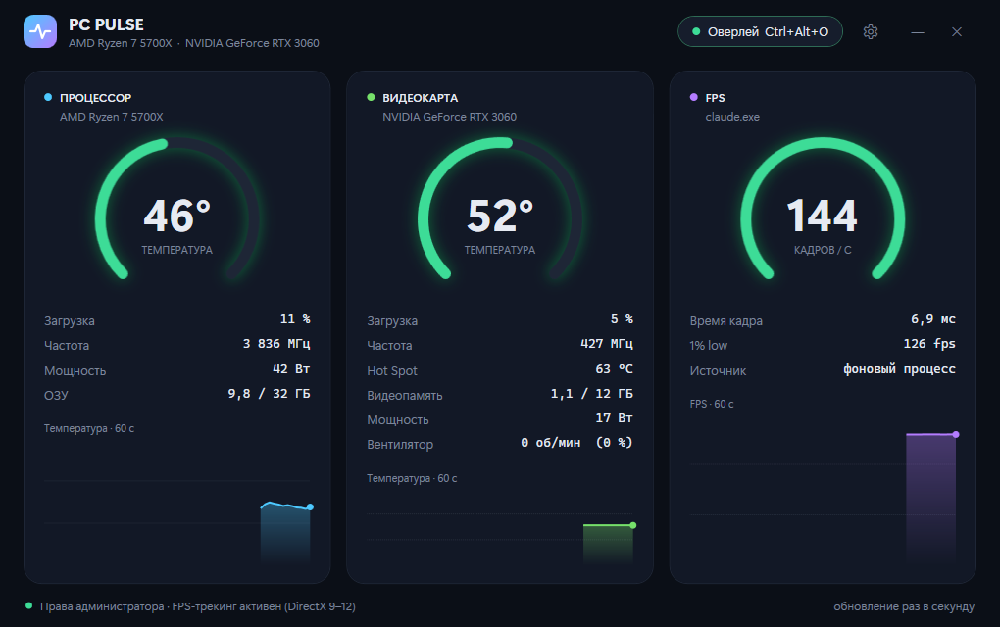

<p align="center">
  
</p>

<h1 align="center">PC Pulse</h1>

<p align="center">
  A lightweight Windows dashboard and in-game overlay for CPU/GPU temperatures, load and FPS.
</p>

<p align="center">
  
</p>

## Features

- **CPU**: temperature, load, clock, package power, RAM usage.
- **GPU**: temperature, hot spot, load, clock, VRAM, power, fan speed.
- **FPS**: frames per second, frame time and 1% low for the game in the foreground. No injection into the game; works the same way as [PresentMon](https://github.com/GameTechDev/PresentMon), through ETW.
- **60-second history** chart on every card; colors go from green to red as temperatures rise or FPS drops.
- **In-game overlay**: a small, click-through, always-on-top panel showing FPS, CPU and GPU. You can put it in any screen corner.
- **System tray**: minimize or close to the tray. The tray tooltip shows current temperatures and FPS.
- **Global hotkeys**, configurable in the settings window:
  - toggle the overlay: `Ctrl+Shift+O`;
  - show or hide the window: `Ctrl+Shift+P`.
- **Single instance**: launching the app again brings the running window to the front, even from the tray.
- **No network access, no telemetry.** Settings live in `%APPDATA%\PC Pulse`.

## Requirements

- Windows 10 or 11, x64.
- [.NET 10 Desktop Runtime](https://dotnet.microsoft.com/download/dotnet/10.0); to build from source you need the .NET 10 SDK instead.
- **Administrator rights.** The app asks for elevation on start. Reading FPS through ETW and reading CPU sensors both require it. If you decline, the GPU, RAM and CPU load still work.
- **AMD Ryzen CPU temperature, clock and power** also need the [PawnIO](https://pawnio.eu/) driver, which LibreHardwareMonitor uses for low-level hardware access:

  ```powershell
  winget install namazso.PawnIO
  ```

## Install

Build and install to `C:\Program Files\PC Pulse`, with a Start menu shortcut:

```powershell
powershell -ExecutionPolicy Bypass -File tools\install.ps1
```

The script runs the tests and builds the app as the current user. It asks for elevation (one UAC prompt) only to copy the files.

The app always runs elevated, so install it to a folder only administrators can write to, such as Program Files. If ordinary users can write to the app's folder, they can replace its DLLs and get administrator rights the next time you run it.

To just run it from source:

```powershell
dotnet run --project PcPulse
```

## Usage

| Action | How |
|---|---|
| Show or hide the overlay | `Ctrl+Shift+O`, the **Overlay** button, or the tray menu |
| Show or hide the window | `Ctrl+Shift+P`, or click the tray icon |
| Change hotkeys, overlay corner, tray behavior | ⚙ in the window header, or **Settings…** in the tray menu |
| Quit | **Exit** in the tray menu, or ✕ (unless ✕ is set to minimize to the tray) |

The FPS card shows the foreground window's frame rate. If the foreground window isn't drawing frames (for example, you are looking at PC Pulse itself), it shows the busiest other process instead.

### Limitations

- FPS tracking covers **DirectX 9–12**. Vulkan and OpenGL games are only seen when they present through DXGI. On NVIDIA you can force that with *Vulkan/OpenGL present method → Prefer layered on DXGI Swapchain*.
- The overlay is a normal topmost window. It shows over **borderless and windowed** games, but not over exclusive fullscreen.
- Some anti-cheat systems check for drivers that access hardware directly. PC Pulse itself doesn't touch game processes, but check your games' rules about PawnIO.

## Diagnostics

| Command or variable | What it does |
|---|---|
| `PcPulse.exe --dump out.txt` | Samples all sensors and FPS for a few seconds and writes them to a text file |
| `PcPulse.exe --no-elevate` | Runs without asking for elevation, next to an installed copy (no FPS) |
| `%APPDATA%\PC Pulse\health.log` | Records memory, handles and CPU use a minute after start and then hourly; `heap` is the live managed heap after a full GC |
| `PCPULSE_HEALTH_MINUTES=1` | Makes the health log write every minute instead of every hour |

## Architecture

```
PcPulse.Core            Models, interfaces and pure logic (FPS math, process selection, polling loop, settings).
                        No Windows, WPF or sensor-library dependencies.
PcPulse.Infrastructure  Implementations of those interfaces: LibreHardwareMonitor sensors, ETW present events,
                        Win32 queries, JSON settings, health log.
PcPulse                 WPF app (MVVM). ShellController holds the app's behavior (tray, hotkeys, windows,
                        settings) and talks to every UI part through an interface.
                        AppBootstrapper is the composition root.
PcPulse.Tests           xUnit tests for the core logic and settings compatibility.
```

To add a dashboard card, subclass `MetricCardViewModel` and register it in `AppBootstrapper`; the window layout picks it up automatically.

```powershell
dotnet test
```

## Third-party components

- [LibreHardwareMonitorLib](https://github.com/LibreHardwareMonitor/LibreHardwareMonitor) — MPL-2.0
- [Microsoft.Diagnostics.Tracing.TraceEvent](https://github.com/microsoft/perfview) — MIT
- [PawnIO](https://pawnio.eu/) — installed separately, not distributed with PC Pulse

## License

[Apache License 2.0](LICENSE.txt)
